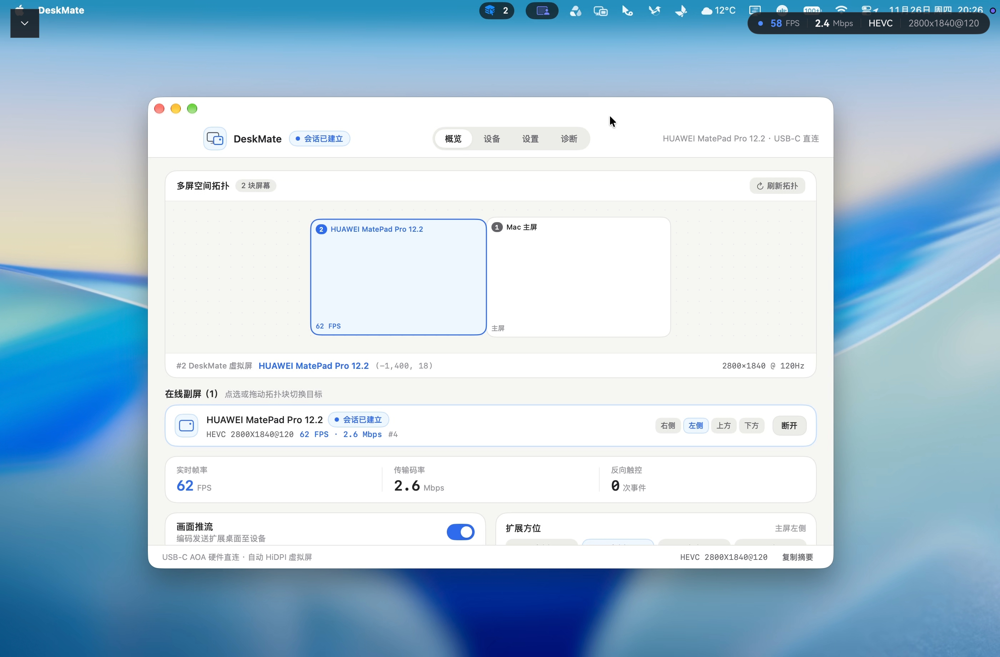
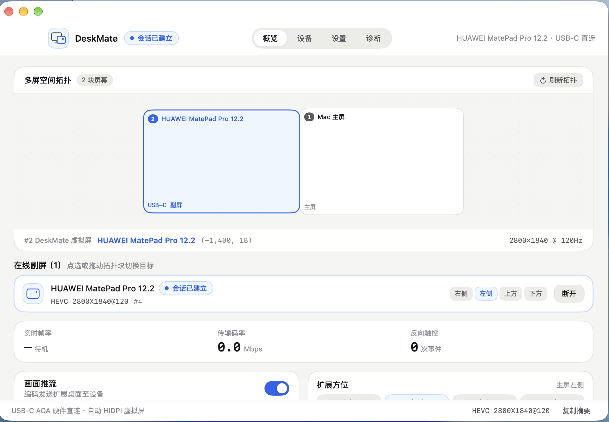

<div align="center">

# DeskMate

**将鸿蒙（HarmonyOS）与 Android 平板/手机通过 USB 有线连接变成 macOS / Windows 的低延迟、高刷新率扩展副屏 —— 支持多设备同时接入与四模式反向触控。**

[](./apps/macos-host)
[](./apps/windows-host)
[](./apps/harmonyos-client)
[](./apps/android-client)
[](#系统架构)
[](#核心特性)
[](#仓库结构)
[](./LICENSE)

简体中文 | [English](./README.en.md)

</div>

---

<div align="center">
  
  <br />
  <sub>
    <i>扩展副屏实拍：<b>HUAWEI MatePad Pro 12.2</b>（主屏左侧，2800×1840 @ 120 Hz HEVC 硬件直出），右上角悬浮胶囊实时显示当前帧率、码率与协商分辨率。</i>
  </sub>
  <br /><br />
  
  <br />
  <sub>
    <i>主控工作台：全新 <b>Quiet Squircle</b> 界面设计，支持系统浅/深双色自适应、顶部居中胶囊导航、实时多屏空间拓扑排布与链路遥测。</i>
  </sub>
</div>

---

## 为什么做 DeskMate？

DeskMate 只需一根 USB 数据线，即可把闲置或手边的鸿蒙 / Android 平板与手机变成 **macOS 与 Windows** 电脑的原生级扩展显示器 —— **不依赖 Wi-Fi、无无线波动、即插即用独立扩展副屏**。

与常见的无线投屏方案不同，DeskMate 在 **USB Accessory (AOA)** 双向 Bulk 通道上构建了自研低延迟二进制流式协议，结合 **macOS（ScreenCaptureKit + VideoToolbox + CGVirtualDisplay）**、**Windows（DXGI Desktop Duplication + Media Foundation + Parsec VDD 虚拟屏）** 与移动端 **C++ / AVCodec / MediaCodec** 硬件解码，实现高帧率画面传输与跟手的反向触控体验。

---

## 核心特性

| 特性 | 说明 |
| --- | --- |
| **USB-C AOA 有线直连** | 全双工 USB Bulk 传输（`usb_byte_io` + `fd_byte_io`），零无线干扰、无网络环境也能随时开双屏甚至多屏办公。 |
| **macOS & Windows 双主控支持** | 提供原生 SwiftUI 工作台（`apps/macos-host`）与轻量单文件 Direct2D 工作台（`apps/windows-host`），共享统一 **Quiet Squircle**（浅/深双色自适应）体验与核心协议栈。 |
| **多设备独立虚拟扩展屏** | 支持 **2 台及以上平板 / 手机同时接入**：macOS 自动创建独立 `CGVirtualDisplay`，Windows 结合 **Parsec VDD** 自动创建独立虚拟扩展屏（不占用电脑已有物理副屏），在主屏四周无重叠排布。 |
| **最高 120 Hz 硬件编解码** | 基于 `VideoToolbox` / `Media Foundation` 硬编与 `AVCodec` / `MediaCodec` 硬解 **HEVC / H.264**，自动匹配设备原始分辨率与刷新率（`60 / 90 / 120 Hz`）。 |
| **四模式反向触控输入** | 直接在平板 / 手机屏幕上操作电脑：支持 **兼容手势映射**、**仅单点触控**、**虚拟妙控板 / 触控板**、**原生屏幕触控**，并适配桌面端四向拓扑映射。 |
| **平板 & 手机全端适配** | 手机端在连接前自动保持**竖屏**浏览，进入副屏画面后自动切换为**横屏自适应**并兼容挖孔屏安全区；支持设备授权控制、自定义备注名、方位记忆与系统托盘/菜单栏控制。 |
| **应用内签名自动更新** | macOS 与 Windows 主控端支持直接从 GitHub Releases 检查更新（基于 `update-manifest.json` 的 **SHA-256 + Ed25519** 双重校验），支持可选 GitHub 加速前缀；Windows 原地替换免重装驱动，macOS 免触发 Quarantine 隔离。 |

---

## 系统架构

DeskMate 将与操作系统无关的协议状态机、调度器和恢复逻辑沉淀在零第三方依赖的 C++20 共享核心 [`core/`](./core) 中，两端仅负责各自的 USB I/O、图形编解码和系统交互：

```text
┌────────────────────────────────────────────────────────────────────────────┐
│    macOS Host (apps/macos-host)    │   Windows Host (apps/windows-host)    │
│  SwiftUI · CGVirtualDisplay        │ Direct2D UI · Parsec VDD / MttVDD     │
│  ScreenCaptureKit + VideoToolbox   │ DXGI Duplication + Media Foundation   │
│  CGEvent / Virtual HID             │ WinUSB AOA + SendInput / TouchInject  │
└────────────────────────────────────┴───────────────────────────────────────┘
                                        │  共享 C++20 核心 (core/)
                                        │  32B 协议头 · HostSession · 发送调度器
                                        │  IDR 恢复门控 · 跨端校时
                                        ▼
                            USB-C AOA (Bulk IN / OUT)
                                        │
                                        ▼
┌────────────────────────────────────────────────────────────────────────────┐
│    HarmonyOS (apps/harmonyos-client)  与  Android (apps/android-client)    │
│  Quiet Squircle 自适应界面（浅/深双色 · 平板双栏 / 手机竖屏进横屏出）     │
│  原生引擎 (N-API / JNI)  ·  POLLIN ByteIo  ·  AVCodec / MediaCodec 硬解直出 │
│  多点触控原生采集 ──────────────────────────────────▶ 反向输入回传           │
└────────────────────────────────────────────────────────────────────────────┘
```

---

## 快速上手（使用指南）

> **💡 觉得手动编译太复杂？**
> 推荐直接下载下方对应平台的预编译安装包；若需从源码定制，也可以把本仓库地址（`https://github.com/SupremacySakura/desk-mate`）交给你的 AI 编程助手（如 **Antigravity**、**Claude Code**、**Cursor**、**Codex**）协助拉取构建。

### 方式一：直接下载预编译安装包（推荐）

前往 [**GitHub Releases**](https://github.com/SupremacySakura/desk-mate/releases/latest) 下载对应平台安装包：

1. **macOS 端（`DeskMate-v*-macos-arm64.dmg`）**
   - 双击打开 `.dmg`，将 **DeskMate.app** 拖入 **Applications（应用程序）**（已内置 `libusb`，**无需安装 Xcode 或 Homebrew**）。
   - 由于安装包使用本地临时签名（未经 Apple 公证），首次启动如遇「已损坏 / 无法验证开发者」提示，在终端运行一次下方命令解除隔离即可：
     ```bash
     xattr -dr com.apple.quarantine /Applications/DeskMate.app
     ```
2. **Windows 端（`DeskMate-v*-windows-x64.zip`）**
   - 解压后直接双击运行静态链接的 **`DeskMateHost.exe`**（无需安装 VC++ 运行库或额外 DLL）；**压缩包 `drivers/` 目录已内置 `zadig-2.9.exe` 与 `parsec-vdd-0.45.0.0-setup.exe`**，一次下载即可完成全部配置。
   - ⚠️ **Windows 首次使用必看**：请按下方 **[Windows 端首次配置指南（Zadig + Parsec VDD）](#windows-端首次配置指南必读)** 完成 **Zadig 安装 WinUSB 驱动** 与 **Parsec VDD 虚拟屏驱动安装**（也可直接在工作台界面点击 **「启动 Zadig」/「安装驱动」** 一键调起内置工具）。
3. **Android 端（`DeskMate-v*-android.apk`）** *（下载即装）*
   - 直接下载 `.apk` 到 Android 8.0+ 平板或手机安装即可使用（内置 `arm64-v8a` 真机与 `x86_64` 架构，无需配置 Android Studio 或开启 USB 调试）。
4. **鸿蒙端（`DeskMate-v*-harmonyos-unsigned.hap`）**
   - HarmonyOS NEXT 系统**不支持直接安装未签名的 `.hap`**；提供未签名包是为了省去安装 DevEco Studio 与编译 C++ 原生代码的步骤。
   - 下载后请使用你自己的华为调试证书（绑定设备 UDID），通过 `hap-sign-tool` 或常用鸿蒙重签工具重签后 `hdc install` 安装，或直接按下方「方式二」在 DevEco Studio 中一键运行安装。

---

## Windows 端首次配置指南（必读）

Windows 系统与 macOS 的底层机制不同，首次使用 `DeskMateHost.exe` 前请务必完成以下 **两步驱动安装**（只需配置一次）：

### 步骤 1：使用 Zadig 安装 USB AOA（WinUSB）驱动

Windows 默认不会为手机切换至 Android Open Accessory（AOA）配件模式后的接口绑定 `WinUSB` 驱动，导致 `libusb` 无法读取 USB Bulk 通道（常见症状：手机端点击「允许访问 USB 配件」后，Windows 端仍一直停在「等待 USB 接入」或卡在协商）。

1. 直接双击压缩包内置的 **`drivers\zadig-2.9.exe`**（或在 DeskMate 工作台点击 **「启动 Zadig」**；若单独拷贝了 exe，也可前往 [**Zadig 官网**](https://zadig.akeo.ie/) 下载），**以管理员身份运行**。
2. 用 USB-C 数据线连接手机/平板，打开 Windows 版 `DeskMateHost.exe` 与手机端 `DeskMate`，触发一次 AOA 切换（手机弹出配件权限时点**允许**）。
3. 在 Zadig 顶部菜单勾选 **`Options` → `List All Devices`**。
4. 在设备下拉列表中找到并选中手机切换后的 **USB AOA / Android Accessory 接口**（USB ID 为 **`18D1:2D00`** 或 **`18D1:2D01`**，通常为 **`Interface 0`**）。
   > ⚠️ **注意**：切勿误选 `12D1:5000`（HDC）或 MTP 接口，请确认左下角 USB ID 显示为 `18D1` 开头后再替换驱动。
5. 将目标驱动选框保持为 **`WinUSB`**，点击 **`Install Driver`**（或 **`Replace Driver`**）等待安装完成。
6. **补充提示**：
   - （可选替代）如果你不想逐台设备绑定 WinUSB，也可以安装 [**UsbDk**](https://github.com/daynix/UsbDk/releases) 过滤驱动。
   - 使用 DeskMate 期间，请退出电脑后台可能抢占手机 USB 接口的 **`hdc.exe`**、**`adb.exe`** 或 **华为手机助手** 进程。
7. 安装完毕后打开 DeskMate **「设置 → 系统环境与驱动」**，确认 **USB / WinUSB 驱动**状态显示为绿色就绪。

### 步骤 2：安装 Parsec VDD 创建独立虚拟扩展屏

Windows 没有像 macOS `CGVirtualDisplay` 那样的系统级用户态虚拟显示器接口；若系统缺少虚拟显示器驱动，DeskMate 无法“凭空变出”新屏幕（在双屏物理显示器电脑上只能复用或镜像已有屏幕）。

1. 直接双击压缩包内置的 **`drivers\parsec-vdd-0.45.0.0-setup.exe`**（或在 DeskMate 工作台点击 **「安装驱动」**；也可前往 [**Parsec VDD Releases**](https://github.com/nomi-san/parsec-vdd/releases) 下载安装最新版）安装 **Parsec Virtual Display Driver**（具备微软 WHQL 正式签名，**无需开启 Windows 测试模式**；同时也兼容 **MttVDD / Virtual Display Driver**）。
2. 安装完成后，**不需要手动打开或常驻 `ParsecVDisplay` 界面程序**（请关闭手动打开的 ParsecVDisplay 托盘，避免与 DeskMate 争抢虚拟屏索引）。
3. **全自动生命周期管理**：
   - 当手机/平板接入并完成握手后，`DeskMateHost.exe` 会直接通过驱动 IOCTL 通知 Parsec VDD **自动创建**一块独立虚拟扩展屏，并匹配手机/平板分辨率与刷新率；
   - 自动将虚拟屏错开排布在你已有物理显示器的指定方位（**绝不抢占你电脑原有的真实显示器**）；
   - 当设备断开或退出 DeskMate 时，自动移除该虚拟显示器并保持桌面干净。
4. 打开 DeskMate **「设置 → 系统环境与驱动」**，确认 **「虚拟显示器驱动」** 一栏显示为 **「Parsec VDD 已就绪」**（绿色）。

---

### 方式二：从源码编译安装

#### 环境要求

- **Mac 端**：macOS 15.0+、Xcode 命令行工具（`xcode-select --install`）、Homebrew 安装 [`libusb`](https://formulae.brew.sh/formula/libusb)
- **Windows 端**：Windows 10/11 (x64)、Visual Studio 2022（Desktop C++ & Windows SDK 10.0.22621+）+ CMake 3.20+ + `vcpkg install libusb:x64-windows`（或无 VS 环境直接使用 `apps/windows-host/build-portable.ps1` + `llvm-mingw` + `libusb-1.0.30`）
- **Android 设备端**：Android SDK 35 与 NDK 27+（离线脚本不依赖 Gradle / Maven 网络），支持数据传输的 USB-C 数据线
- **鸿蒙设备端**：HarmonyOS NEXT（`compatibleSdkVersion 6.1.1(24)` / `targetSdkVersion 26.0.0`）、**DevEco Studio**（用于签名安装客户端 `.hap`）、支持数据传输的 USB-C 数据线

#### 第一步：克隆仓库并构建桌面主控端

- **macOS Host（`apps/macos-host`）**：
  ```bash
  git clone https://github.com/SupremacySakura/desk-mate.git
  cd desk-mate

  brew install libusb
  cd apps/macos-host
  make app        # 或 `make dmg` 打出内置 libusb 的离线 .dmg
  open build/DeskMate.app
  ```
  > **提示**：如果你在 Intel Mac 等环境中将 `libusb` 安装在其他路径（如 `/usr/local`），可传 `LIBUSB_PREFIX=/usr/local make app`。如需使用固定自签名代码签名证书替代临时签名（配合应用内更新减少重新授权频率），可运行一次 `bash apps/macos-host/scripts/create-self-signed-cert.sh` 并在钥匙串中信任 `DeskMate Local Signer`。

- **Windows Host（`apps/windows-host`）**：
  ```powershell
  # 方式 1：Visual Studio 2022 + CMake + vcpkg
  cmake -S . -B build -G "Visual Studio 17 2022" -A x64 `
    -DCMAKE_TOOLCHAIN_FILE=C:\vcpkg\scripts\buildsystems\vcpkg.cmake `
    -DDESKMATE_BUILD_WINDOWS_HOST=ON
  cmake --build build --config Release

  # 方式 2：无 VS/CMake，用便携 llvm-mingw + libusb 源码直接产出单文件 exe
  powershell -ExecutionPolicy Bypass -File apps/windows-host/build-portable.ps1 `
    -ToolchainDir C:\dm\llvm-mingw-20261117-ucrt-x86_64 `
    -LibusbSource C:\dm\libusb-1.0.30 `
    -OutputDir    C:\dm\build
  ```

#### 第二步：构建并安装移动客户端

- **Android 客户端（`apps/android-client`）**：
  ```bash
  # 离线编译并签名生成 app/build/outputs/apk/debug/app-debug.apk
  ANDROID_HOME=~/Library/Android/sdk NDK=~/Library/Android/sdk/ndk/27.2.12479018 \
    bash apps/android-client/package_apk.sh
  adb install -r apps/android-client/app/build/outputs/apk/debug/app-debug.apk
  ```
- **HarmonyOS NEXT 客户端（`apps/harmonyos-client`）**：
  1. 使用 **DevEco Studio** 打开 [`apps/harmonyos-client`](./apps/harmonyos-client)。
  2. 用 USB 数据线连接你的鸿蒙平板或手机（确保设备已开启开发者模式 / USB 调试）。
  3. 在 DevEco Studio 中配置个人调试签名（**File → Project Structure → Signing Configs**）。
     > **注意**：请勿将个人的 `signingConfigs` 提交进 `apps/harmonyos-client/build-profile.json5`。
  4. 点击 **Run (`entry`)**，将 DeskMate 安装到你想作为副屏使用的每台鸿蒙设备上。

#### 第三步：本地打包产物存放目录约定

所有本地编译打包后的最终安装包统一存放在 `dist/<platform>/` 下（切勿放在仓库根目录），中间编译缓存留在各端 `build/` 目录：

| 平台 | 最终交付目录 | 典型产物 | 中间构建目录 |
| --- | --- | --- | --- |
| **Windows Host** | `dist/windows/` | `DeskMateHost.exe`、`DeskMate-v*-windows-x64.zip` | `build/` 或 `apps/windows-host/build/` |
| **macOS Host** | `dist/macos/` | `DeskMate-v*-macos-*.dmg`、`DeskMate-v*-macos-*.zip` | `apps/macos-host/build/` |
| **Android Client** | `dist/android/` | `DeskMate-v*-android-debug.apk` | `apps/android-client/app/build/` |
| **HarmonyOS Client** | `dist/harmonyos/` | `DeskMate-v*-harmonyos-*.hap` | `apps/harmonyos-client/entry/build/` |

#### 第四步：完成系统权限与驱动准备

- **macOS**：按界面引导授予 **屏幕录制权限**（用于 `ScreenCaptureKit`）与 **辅助功能权限**（用于反向触控；点主窗口或菜单栏 **「一键获取」**，覆写重编后如失效点 **「重置旧授权」**）。
- **Windows**：完成上方 **[Windows 端首次配置指南](#windows-端首次配置指南必读)** 中的 **Zadig WinUSB 绑定** 与 **Parsec VDD 安装**，并在 DeskMate **「设置 → 系统环境与驱动」** 确认全绿就绪。

#### 第四步：连接一台或多台设备作为副屏

1. 在平板或手机上打开 **DeskMate** 应用。
2. 用 USB 数据线将一台或多台设备接入电脑。
3. 当设备屏幕弹出 **「是否允许访问 USB 配件」** 时点击 **允许**。
4. 桌面端会自动为每台设备创建匹配其分辨率与刷新率的 **独立虚拟显示器**，并按空闲方向无重叠排布（右 / 左 / 下 / 上）。
5. 将窗口拖入副屏即可开始使用；点击左侧 **拓扑布局图** 或设备卡片上的 **「右侧 / 左侧 / 上方 / 下方」** 按钮可随时调整屏幕位置。

---

## 反向触控输入模式说明

可在桌面端 **「设置 → 触控输入」** 或 **菜单栏/托盘** 中随时切换：

| 模式 | 说明 |
| --- | --- |
| **兼容手势映射** *（默认）* | 单指点击 / 拖动 / 移动指针；双指滚动 / 右键轻点 / 捏合缩放；macOS 支持三指/四指调度中心与空间切换（`⌃←/→/↑/↓`），Windows 通过 `SendInput` 映射快捷键与滚轮。 |
| **仅单点触控** | 只保留单指点击与长按拖动，屏蔽多指手势，适合手写或单一控件操作，避免误触系统快捷键。 |
| **虚拟触控板（实验性）** | 将设备屏幕作为相对移动触控板使用，支持长按后拖动锁存；macOS 在具备 Virtual HID 权限时直通 `IOHIDUserDevice`。 |
| **原生屏幕触控（实验性）** | 直接透传多点触控坐标：macOS 通过 `IOHIDUserDevice`（未签名时自动回退兼容手势），Windows 通过 Win32 `InitializeTouchInjection` 原生注入。 |

---

## 命令行参数与自动化测试

### macOS Host CLI（`apps/macos-host/build/DeskMate.app/Contents/MacOS/DeskMate`）

```bash
./build/DeskMate.app/Contents/MacOS/DeskMate --list-displays
./build/DeskMate.app/Contents/MacOS/DeskMate --codec h264 --fps 60
./build/DeskMate.app/Contents/MacOS/DeskMate --display-id <显示器ID>
./build/DeskMate.app/Contents/MacOS/DeskMate --dry-run
```

| 参数 | 默认值 | 说明 |
| --- | --- | --- |
| `--display-id N` | 自动创建虚拟屏 | 借用指定的已有扩展显示器，而非自动生成虚拟显示器 |
| `--create` | 关 | 强制自建 `CGVirtualDisplay` |
| `--width` / `--height` | `2800` / `1840` | 关闭自动匹配分辨率时的默认采集像素尺寸 |
| `--fps N` | `60` | 默认目标帧率（`60` / `90` / `120`） |
| `--codec NAME` | `hevc` | 视频编码格式：`hevc` 或 `h264` |
| `--list-displays` | — | 打印当前在线显示器列表后退出 |
| `--dry-run` | 关 | 仅本地采集编码测试，不连接 USB |

### Windows Host CLI（`DeskMateHost.exe`）

```powershell
.\DeskMateHost.exe --list-monitors
.\DeskMateHost.exe --codec hevc --fps 60
.\DeskMateHost.exe --headless
```

### 运行自动化测试

```bash
# 1. 运行共享 C++20 核心测试（协议编解码、Session 状态机、调度器）
make test

# 2. 运行跨平台通用层、Windows 契约测试与 Android fd I/O 测试
bash apps/common/tests/run_platform_tests.sh

# 3. 编译 macOS Host 并运行打包契约与多设备 USB 桥接单元测试
make -C apps/macos-host test
```

---

## 仓库结构

```text
desk-mate/
├── core/                      # 跨平台 C++20 核心库：线缆协议、Session 状态机、发送调度器与单元测试
├── apps/
│   ├── common/                # 跨端共用适配层（AOA ID、Session 配置、12 KiB 策略、Annex-B）
│   ├── macos-host/            # macOS 主控端（SwiftUI 界面、ScreenCaptureKit、VideoToolbox、CGVirtualDisplay、libusb）
│   ├── windows-host/          # Windows 主控端（Direct2D 工作台、Parsec VDD 虚拟屏、DXGI、Media Foundation、WinUSB、SendInput）
│   ├── harmonyos-client/      # HarmonyOS NEXT 客户端（ArkTS 自适应界面 + C++ N-API AOA 通信与 AVCodec 硬解）
│   └── android-client/        # Android 客户端（UsbManager 配件 fd、MediaCodec Surface、MotionEvent 触控）
├── docs/
│   ├── assets/                # README 展示图片等资源
│   ├── architecture.md        # 工程架构设计与双端平台边界说明
│   ├── protocol.md            # 详细线缆格式、Session API 与 Golden Vectors 协议规范
│   ├── verification-notes.md  # 自动化测试、真机排障修复与门禁记录
│   └── adr/                   # 架构决策记录（ADR）
├── testdata/golden/           # 独立生成的二进制协议 Golden 测试向量
├── GLOSSARY.md                # 项目领域术语表
├── CMakeLists.txt             # 跨平台 CMake 构建入口（Windows Host / Common Tests）
└── Makefile                   # C++20 核心库编译与测试入口
```

---

## 常见问题排查

- **Windows：手机点允许后仍显示等待接入，或一直卡在协商 / 没出画面**
  请按 **[步骤 1：Zadig 驱动安装](#步骤-1使用-zadig-安装-usb-aoawinusb-驱动)** 为设备的 `18D1:2D00` / `18D1:2D01`（Interface 0）绑定 **WinUSB** 驱动（或安装 **UsbDk**），并彻底退出后台占用 USB 的 `hdc`、`adb` 或手机助手程序。
- **Windows：连接后手机只显示电脑已有屏幕或全黑，没有扩展出新屏幕**
  请确认已安装 **[Parsec VDD](#步骤-2安装-parsec-vdd-创建独立虚拟扩展屏)** 并在 DeskMate **「设置 → 系统环境与驱动」** 显示为绿色；若手动开启了 `ParsecVDisplay` 窗口，请关闭它后重新插拔设备让 DeskMate 自动创建虚拟屏。
- **连接后一直停在「等待设备确认」（`awaiting_client_hello`）**
  请确认手机/平板上已打开 **DeskMate** 并停留在前台，且在系统弹出的「允许访问 USB 配件」提示框中点击了 **允许**。
- **macOS：已显示「正在发送画面」，但设备侧无画面或黑屏**
  检查 Mac **系统设置 → 隐私与安全性 → 屏幕录制与系统音频录制** 中是否勾选了 `DeskMate`；若刚重新授权或重编应用，请重启 DeskMate 再试。
- **macOS：诊断中显示收到触控事件，但 Mac 光标无响应**
  检查是否开启了 **「平板触控回传」** 开关，并点击 **「一键获取」**（若重新编译覆盖过 `.app`，建议点 **「重置旧授权」** 后重新勾选辅助功能）。
- **强制退出 Host 后设备停留在 USB 配件模式**
  拔下 USB 数据线重新插一次即可恢复为常规 HDC / MTP 传输模式。

---

## 参与贡献与技术文档

- 工程架构与双端平台说明：[docs/architecture.md](./docs/architecture.md)
- 协议与线缆格式规范：[docs/protocol.md](./docs/protocol.md)
- 自动化测试与真机排障总结：[docs/verification-notes.md](./docs/verification-notes.md)
- macOS Host 开发与调试说明：[apps/macos-host/README.md](./apps/macos-host/README.md)
- Windows Host 驱动、构建与设计说明：[apps/windows-host/README.md](./apps/windows-host/README.md)
- HarmonyOS 客户端说明：[apps/harmonyos-client/README.md](./apps/harmonyos-client/README.md)
- Android 客户端说明：[apps/android-client/README.md](./apps/android-client/README.md)
- 领域术语表：[GLOSSARY.md](./GLOSSARY.md)

欢迎提交 Issue 与 Pull Request，一起完善 **macOS / Windows / HarmonyOS / Android** 全平台有线副屏体验！

---

## 开源与使用协议

本项目采用 **[PolyForm Noncommercial License 1.0.0](./LICENSE)**（`Copyright (c) 2026 SupremacySakura`）：

- **个人自用与非商业用途免费**：允许在个人学习、自用及非商业场景下免费使用、研究、修改与非商业分发。
- **商用需提前授权**：任何商业用途（包括但不限于商业软件分发、商业产品集成、SaaS 服务或企业商业经营使用）均须事先获得作者（`SupremacySakura`）的书面授权。如需商业授权，请通过 GitHub Issue 联系作者。
