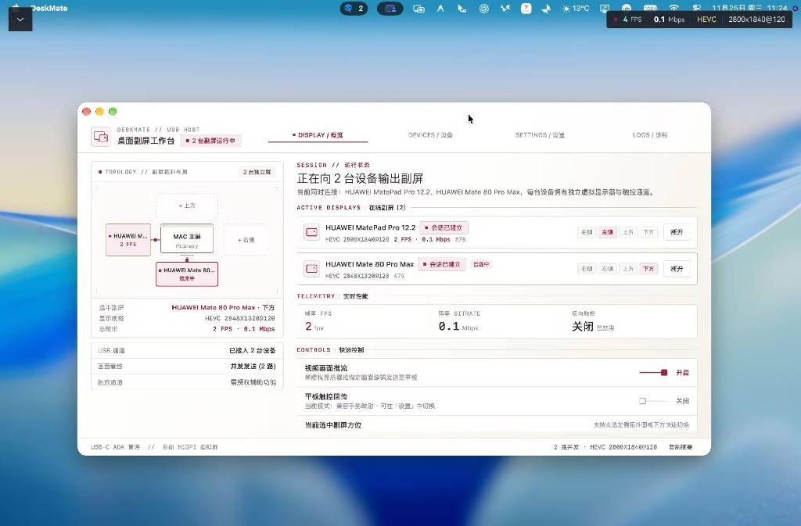

<div align="center">

# DeskMate

**将鸿蒙（HarmonyOS）平板与手机通过 USB 有线连接变成 macOS 的低延迟、高刷新率扩展副屏 —— 支持多设备同时接入与四模式反向触控。**

[](./apps/host)
[](./apps/device)
[](#系统架构)
[](#核心特性)
[](#仓库结构)
[](./LICENSE)

[English](./README.md) | 简体中文

</div>

---

<div align="center">
  
  <br />
  <sub>
    <i>双设备并发运行实拍：<b>HUAWEI MatePad Pro 12.2</b>（主屏左侧，2800×1840 @ 120 Hz）与 <b>HUAWEI Mate 80 Pro Max</b>（主屏下方，2848×1320 @ 120 Hz）通过 USB-C AOA 同时接入，开启硬件加速 HEVC 并发推流。</i>
  </sub>
</div>

---

## 为什么做 DeskMate？

DeskMate 只需一根 USB 数据线，即可把闲置或手边的鸿蒙平板、手机变成 Mac 的原生级扩展显示器 —— **不依赖 Wi-Fi、无无线波动、无需外部虚拟屏插件，即插即用 HiDPI 扩展屏。**

与常见的无线投屏方案不同，DeskMate 在 **USB Accessory (AOA)** 双向 Bulk 通道上构建了自研低延迟二进制流式协议，结合 macOS 原生 **ScreenCaptureKit + VideoToolbox** 硬件编码与鸿蒙端 **C++ / AVCodec** 硬件解码，实现高帧率画面传输与跟手的反向触控体验。

---

## 核心特性

| 特性 | 说明 |
| --- | --- |
| **USB-C AOA 有线直连** | 全双工 USB Bulk 传输（`UsbByteIo` + `FdByteIo`），零无线干扰、无网络环境也能随时开双屏甚至多屏办公。 |
| **多设备同时作为副屏** | 支持 **2 台及以上鸿蒙平板 / 手机同时接入**。每台设备拥有独立的 `CGVirtualDisplay`、独立编码推流管线、独立触控状态机，并在主屏四周自动无重叠排布。 |
| **最高 120 Hz 硬件编解码** | 基于 Apple `VideoToolbox` 与 HarmonyOS `OH_VideoDecoder`（`AVCodec`）硬解硬编 **HEVC / H.264**，自动匹配设备原始宽高比与刷新率（`60 / 90 / 120 Hz`）。 |
| **四模式反向触控输入** | 直接在平板 / 手机屏幕上操作 macOS：支持 **兼容手势映射**、**仅单点触控**、**虚拟妙控板（实验性）**、**原生屏幕触控（实验性）**，支持一键弹窗授权辅助功能。 |
| **平板 & 手机全端适配** | 两端采用统一 **Alabaster Studio** 视觉设计；鸿蒙手机端在连接前自动保持**竖屏**浏览，进入副屏画面后自动切换为**横屏自适应**并兼容挖孔屏安全区。 |
| **已配对设备与方位记忆** | 支持连接权限开关（允许/拦截）、设备重命名、为每台设备单独记住默认副屏方位（左 / 右 / 上 / 下）、在线独立断开。 |
| **菜单栏浮窗与自启控制** | 菜单栏实时查看总 FPS / 码率 / 触控次数、快速切换当前控制设备、支持开机自启（`ServiceManagement`）与自动开启串流服务。 |

---

## 系统架构

DeskMate 将与操作系统无关的协议状态机、调度器和恢复逻辑沉淀在零第三方依赖的 C++20 共享核心 [`core/`](./core) 中，两端仅负责各自的 USB I/O、图形编解码和系统交互：

```text
┌────────────────────────────────────────────────────────────────────────────┐
│                             macOS Host (apps/host)                         │
│  SwiftUI 工作台  ·  CGVirtualDisplay  ·  ScreenCaptureKit + VideoToolbox    │
│  InputInjector（4 模式 CGEvent / Virtual HID） ·  libusb 多链路 AOA 调度中心  │
└───────────────────────────────────────┬────────────────────────────────────┘
                                        │  共享 C++20 核心 (core/)
                                        │  32B 协议头 · HostSession · 发送调度器
                                        │  IDR 恢复门控 · 跨端校时
                                        ▼
                            USB-C AOA (Bulk IN / OUT)
                                        │
                                        ▼
┌────────────────────────────────────────────────────────────────────────────┐
│                        HarmonyOS Client (apps/device)                      │
│  ArkTS 自适应界面（平板双栏 / 手机竖屏进横屏出）                              │
│  N-API 原生引擎  ·  fd_byte_io (POLLIN)  ·  AVCodec 硬件解码上屏             │
│  XComponent 原生多点触控采集 ──▶ 反向输入回传                                │
└────────────────────────────────────────────────────────────────────────────┘
```

---

## 快速上手（使用指南）

> **💡 觉得手动安装太复杂？直接交给 AI Agent！**
> 只需要把本仓库地址（`https://github.com/SupremacySakura/desk-mate`）直接丢给你常用的 AI 编程助手（如 **Antigravity**、**Claude Code**、**Cursor**、**Codex** 等），让它帮你自动拉取仓库、安装依赖、编译 `DeskMate.app` 并引导完成端侧部署即可！

### 方式一：直接下载预编译安装包（推荐）

前往 [**GitHub Releases**](https://github.com/SupremacySakura/desk-mate/releases/latest) 下载对应安装包：

1. **macOS 端（`DeskMate-v*-macos-arm64.dmg`）**
   - 双击打开 `.dmg`，将 **DeskMate.app** 拖入 **Applications（应用程序）**（已内置 `libusb`，**无需安装 Xcode 或 Homebrew**）。
   - 由于安装包使用本地临时签名（未经 Apple 公证），首次启动如遇「已损坏 / 无法验证开发者」提示，在终端运行一次下方命令解除隔离即可：
     ```bash
     xattr -dr com.apple.quarantine /Applications/DeskMate.app
     ```
2. **鸿蒙端（`DeskMate-v*-harmonyos-unsigned.hap`）**
   - HarmonyOS NEXT 系统**不支持直接安装未签名的 `.hap`**；提供未签名包是为了省去安装 DevEco Studio 与编译 C++ 原生代码的步骤。
   - 下载后请使用你自己的华为调试证书（绑定设备 UDID），通过 `hap-sign-tool` 或常用鸿蒙重签工具重签后 `hdc install` 安装，或直接按下方「方式二」在 DevEco Studio 中一键运行安装。

### 方式二：从源码编译安装

#### 环境要求

- **Mac 端**：macOS 15.0+、Xcode 命令行工具（`xcode-select --install`）、Homebrew 安装 [`libusb`](https://formulae.brew.sh/formula/libusb)
- **鸿蒙设备端**：HarmonyOS NEXT（`compatibleSdkVersion 6.1.1(24)` / `targetSdkVersion 26.0.0`）、**DevEco Studio**（用于签名安装客户端 `.hap`）、支持数据传输的 USB-C 数据线（或供电充足的 USB Hub）

#### 第一步：克隆仓库并构建 macOS Host 客户端

```bash
git clone https://github.com/SupremacySakura/desk-mate.git
cd desk-mate

# 安装 libusb 依赖
brew install libusb

# 编译生成 DeskMate.app（也可执行 `make dmg` 打出内置 libusb 的离线 .dmg）
cd apps/host
make app

# 启动 macOS 端
open build/DeskMate.app
```

> **提示**：如果你在 Intel Mac 等环境中将 `libusb` 安装在其他路径（如 `/usr/local`），可通过 `LIBUSB_PREFIX=/usr/local make app` 指定路径。

#### 第二步：构建并安装鸿蒙客户端

1. 使用 **DevEco Studio** 打开项目目录下的 [`apps/device`](./apps/device)。
2. 用 USB 数据线连接你的鸿蒙平板或手机（确保设备已开启开发者模式 / USB 调试）。
3. 在 DevEco Studio 中为当前设备配置个人调试签名（**File → Project Structure → Signing Configs**）。
   > **注意**：如果你计划 Fork 本项目或提交 PR，请勿将个人的 `signingConfigs` 提交进 `apps/device/build-profile.json5`。
4. 点击 **Run (`entry`)**，将 DeskMate 安装到你想作为副屏使用的每台鸿蒙设备上。

#### 第三步：授予 macOS 系统权限

首次打开 `DeskMate.app` 时，请按界面引导完成两项权限授权：

- **屏幕录制权限** *（必需）*：用于允许 `ScreenCaptureKit` 采集虚拟扩展屏幕画面。前往 **系统设置 → 隐私与安全性 → 屏幕录制与系统音频录制** 勾选 `DeskMate`，返回后重启应用或点击重试即可。
- **辅助功能权限** *（开启反向触控时需要）*：用于将设备上的点击、拖动、滚动和多指手势注入回 Mac。点击主窗口或菜单栏中的 **「一键获取」** 即可自动弹出系统注册提示并直达设置页（如重新编译覆盖了 `.app` 导致旧授权失效，可点击 **「重置旧授权」**）。

#### 第四步：连接一台或多台设备作为副屏

1. 在鸿蒙平板或手机上打开 **DeskMate** 应用。
2. 用 USB 数据线将一台或多台设备接入 Mac。
3. 当设备屏幕弹出 **「是否允许访问 USB 配件」** 时点击 **允许**。
4. macOS 端会自动为每台设备创建匹配其分辨率与刷新率的 **独立 HiDPI 虚拟显示器**，并按空闲方向自动排列（右 / 左 / 下 / 上，同侧多设备会自动错开不重叠）。
5. 你可以把任意窗口拖到副屏上使用；点击左侧 **拓扑布局图** 或设备卡片上的 **「右侧 / 左侧 / 上方 / 下方」** 按钮可随时调整每块屏幕的位置。

---

## 反向触控输入模式说明

可在 Mac 端 **「设置 → 触控输入」** 或 **菜单栏浮窗** 中随时切换：

| 模式 | 说明 |
| --- | --- |
| **兼容手势映射** *（默认）* | 单指点击 / 拖动 / 移动指针；双指滚动 / 右键轻点 / 捏合缩放（`⌘+` / `⌘-`）；三指或四指滑动切换桌面空间、打开调度中心与 App Exposé（`⌃←/→/↑/↓`）。 |
| **仅单点触控** | 只保留单指点击与长按拖动，屏蔽多指手势，适合手写或单一控件操作，避免误触系统快捷键。 |
| **虚拟妙控板（实验性）** | 将设备屏幕作为相对移动触控板使用，支持长按后拖动锁存；具备虚拟 HID 签名权限时直通 `IOHIDUserDevice`，否则自动使用相对手势回退实现。 |
| **原生屏幕触控（实验性）** | 当应用具备系统级 Virtual HID 权限时直接透传最多 10 个独立触点，否则自动回退至兼容手势映射。 |

---

## 命令行参数与自动化测试

### Host 命令行参数（`apps/host/build/DeskMate.app/Contents/MacOS/DeskMate`）

```bash
./build/DeskMate.app/Contents/MacOS/DeskMate --list-displays
./build/DeskMate.app/Contents/MacOS/DeskMate --codec h264 --fps 60
./build/DeskMate.app/Contents/MacOS/DeskMate --display-id <显示器ID>
./build/DeskMate.app/Contents/MacOS/DeskMate --dry-run
```

| 参数 | 默认值 | 说明 |
| --- | --- | --- |
| `--display-id N` | 自动创建虚拟屏 | 借用指定的已有扩展显示器，而非自动生成虚拟显示器 |
| `--create` | 关 | 强制自建 `CGVirtualDisplay` |
| `--width` / `--height` | `2800` / `1840` | 关闭自动匹配分辨率时的默认采集像素尺寸 |
| `--fps N` | `60` | 默认目标帧率（`60` / `90` / `120`） |
| `--codec NAME` | `hevc` | 视频编码格式：`hevc` 或 `h264` |
| `--list-displays` | — | 打印当前在线显示器列表后退出 |
| `--dry-run` | 关 | 仅本地采集编码测试，不连接 USB |

### 运行自动化测试

```bash
# 1. 运行共享 C++20 核心测试（协议编解码、Session 状态机、调度器）
make test

# 2. 编译 macOS Host 并运行打包契约与多设备 USB 桥接单元测试
make -C apps/host test
```

---

## 需要 Windows 版或安卓版？交给 AI Agent 参照本项目开发！

目前 DeskMate 仓库内置提供的是 **macOS（主控端 Host） + HarmonyOS NEXT（副屏端 Device）** 的完整实现。

如果你需要在 **Windows 电脑** 上做主控端，或者希望让 **Android 平板 / 手机** 作为副屏接入，完全不需要从零摸索 —— **你可以直接让 AI 编程助手（如 Antigravity、Claude Code、Cursor、Codex 等）以本仓库为蓝本进行跨平台移植开发！**

本项目的代码结构天生非常适合 AI Agent 迁移扩展：
1. **核心协议层 [`core/`](./core) 100% 跨平台可复用**：采用纯标准 C++20 编写，零第三方依赖，包含 32 字节显式小端线缆格式、握手状态机、拥塞丢帧调度器、IDR 恢复门控、时钟同步及 100+ 项单元测试，可直接通过 CMake 在 **Windows（MSVC/Clang）** 与 **Android（NDK）** 编译复用。
2. **平台边界极度清晰（`ByteIo` / `HostBoundary` / `DeviceBoundary`）**：所有 OS 相关逻辑（USB AOA、虚拟显示器、屏幕采集、硬件编解码、触控注入）都清晰隔离在 [`apps/host`](./apps/host) 和 [`apps/device`](./apps/device) 中，AI 可以直接对照两端实现一一映射。

### Windows / Android 移植对照表（供开发者与 AI Agent 参考）

| 模块层 | 本仓库现有实现 | Windows Host 对应方案 | Android Client 对应方案 |
| --- | --- | --- | --- |
| **协议与会话核心** | [`core/`](./core)（C++20） | CMake / MSVC 直接编译接入 [`core/`](./core) | Android NDK CMake 直接编译接入 [`core/`](./core) |
| **USB AOA 传输** | [`Bridge.cpp`](./apps/host/Sources/Bridge.cpp)（`libusb`）· [`fd_byte_io.cpp`](./apps/device/entry/src/main/cpp/fd_byte_io.cpp) | `libusb` / WinUSB 多设备 AOA 切换与并发会话（`PID 0x2D00–0x2D05`） | Android `UsbManager.openAccessory()` 获取 `ParcelFileDescriptor` + NDK `POLLIN` 读循环 |
| **虚拟扩展显示器** | [`DMVirtualDisplay.m`](./apps/host/Sources/DMVirtualDisplay.m) | Windows IddCx 虚拟显示器驱动（如 Virtual-Display-Driver 思路） | 无需虚拟屏（Android 客户端全屏渲染到 `SurfaceView` / `TextureView`） |
| **画面采集与硬件编解码** | `ScreenCaptureKit` + `VideoToolbox` · [`video_decoder.cpp`](./apps/device/entry/src/main/cpp/video_decoder.cpp)（`AVCodec`） | `Windows.Graphics.Capture` / DXGI 抓屏 + Media Foundation / NVENC 硬件编码 | `MediaCodec`（`video/hevc` / `video/avc`）硬解直出 `Surface` |
| **反向触控注入与采集** | [`InputInjector.swift`](./apps/host/Sources/InputInjector.swift) · [`napi_init.cpp`](./apps/device/entry/src/main/cpp/napi_init.cpp) | Win32 `SendInput` / `InitializeTouchInjection` | `View.onTouchEvent`（多指 `MotionEvent`）通过 JNI / NDK 传入 `core/` |

<details>
<summary><b>📋 可直接复制给 AI Agent 的参考开发提示词（Prompt）</b></summary>

```text
请先通读当前 DeskMate 仓库，重点关注 `core/`、`docs/protocol.md`、`apps/host/Sources/Bridge.cpp` 以及 `apps/device/entry/src/main/cpp/`。

目标：参照现有代码架构，为本项目开发一个兼容的【Windows Host（位于 apps/windows-host）/ Android 客户端（位于 apps/android-client）】，要求能够通过 USB AOA 与现有【HarmonyOS 客户端 / macOS Host】原生互通。

要求：
1. 直接复用 `core/`（通过 CMake 引入），不要修改既有的 32 字节协议头、控制 opcode 与 InputEvent 载荷格式。
2. 按照 `core/` 中的 `ByteIo` 与 Session 边界接口实现对应平台适配层（Windows 使用 libusb/WinUSB 多设备 AOA + WGC/DXGI 采集 + Media Foundation 硬件编码 + IddCx 虚拟屏 + SendInput；Android 使用 UsbManager.openAccessory + NDK POLLIN 读写 + MediaCodec Surface 硬解 + MotionEvent 多点触控采集）。
3. 保留多设备并发连接、12 KiB 视频分片上限与全双工非阻塞 USB I/O 设计。
4. 编写构建脚本与协议兼容测试并确保编译通过。
```

</details>

---

## 仓库结构

```text
desk-mate/
├── core/               # 跨平台 C++20 核心库：线缆协议、Session 状态机、发送调度器与单元测试
├── apps/
│   ├── host/           # macOS 主控端（SwiftUI 界面、ScreenCaptureKit、VideoToolbox、CGVirtualDisplay、libusb）
│   └── device/         # HarmonyOS NEXT 客户端（ArkTS 自适应界面 + C++ N-API AOA 通信与 AVCodec 硬解）
├── docs/
│   ├── assets/               # README 展示图片等资源
│   ├── architecture.md       # 工程架构设计与双端平台边界说明
│   ├── protocol.md           # 详细线缆格式、Session API 与 Golden Vectors 协议规范
│   ├── verification-notes.md # 自动化测试、真机排障修复与门禁记录
│   └── adr/                  # 架构决策记录（ADR）
├── testdata/golden/    # 独立生成的二进制协议 Golden 测试向量
├── GLOSSARY.md         # 项目领域术语表
└── Makefile            # C++20 核心库编译与测试入口
```

---

## 常见问题排查

- **连接后一直停在「等待设备确认」（`awaiting_client_hello`）**
  请确认鸿蒙平板/手机上已打开 **DeskMate** 并停留在前台，且在系统弹出的「允许访问 USB 配件」提示框中点击了 **允许**。
- **已显示「正在发送画面」，但设备侧无画面或黑屏**
  检查 Mac **系统设置 → 隐私与安全性 → 屏幕录制与系统音频录制** 中是否勾选了 `DeskMate`；若刚重新授权或重编应用，请重启 DeskMate 再试。
- **诊断中显示收到触控事件，但 Mac 光标无响应**
  检查是否开启了 **「平板触控回传」** 开关，并点击 **「一键获取」**（若重新编译覆盖过 `.app`，建议点 **「重置旧授权」** 后重新勾选辅助功能）。
- **强制退出 Host 后设备停留在 USB 配件模式**
  拔下 USB 数据线重新插一次即可恢复为常规 HDC / 传输模式。

---

## 参与贡献与技术文档

- 工程架构与双端平台说明：[docs/architecture.md](./docs/architecture.md)
- 协议与线缆格式规范：[docs/protocol.md](./docs/protocol.md)
- 自动化测试与真机排障总结：[docs/verification-notes.md](./docs/verification-notes.md)
- macOS Host 开发与调试说明：[apps/host/README.md](./apps/host/README.md)
- 领域术语表：[GLOSSARY.md](./GLOSSARY.md)

欢迎提交 Issue 与 Pull Request！如果你基于本仓库的 [`core/`](./core) 完成了 **Windows Host** 或 **Android 客户端** 的适配，也欢迎分享链接或提交 PR 一起完善多平台生态。

---

## 开源与使用协议

本项目采用 **[PolyForm Noncommercial License 1.0.0](./LICENSE)**（`Copyright (c) 2026 SupremacySakura`）：

- **个人自用与非商业用途免费**：允许在个人学习、自用及非商业场景下免费使用、研究、修改与非商业分发。
- **商用需提前授权**：任何商业用途（包括但不限于商业软件分发、商业产品集成、SaaS 服务或企业商业经营使用）均须事先获得作者（`SupremacySakura`）的书面授权。如需商业授权，请通过 GitHub Issue 联系作者。
